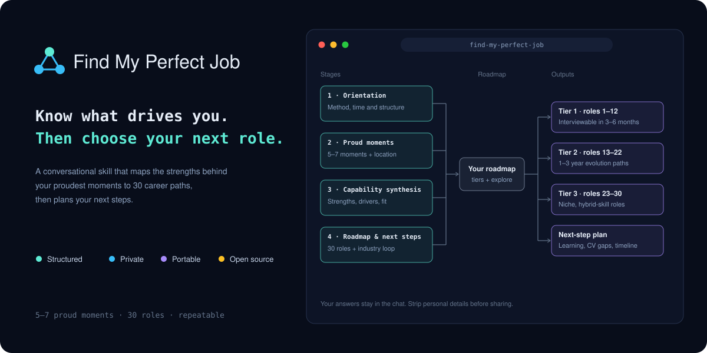

# Find My Perfect Job

A conversational skill that maps your strengths and the fields you are interested in, then turns that map into a practical next-step plan.

Most career tools match CV keywords to job descriptions. This skill starts with what you are proud of, which strengths show up across your life, and what drains you. It then uses that picture to suggest directions you might not have considered.

## What it does

- **Finds your patterns** from 5–7 moments you are proud of, across work, study, hobbies, and personal life
- **Sets salary expectations** for six months and the long term, so every suggestion is checked against them
- **Suggests 30 roles** in three tiers: immediate moves, mid-term evolution, and niche intersections
- **Expands any interest** into 30 related industries, repeatable until you are satisfied
- **Plans your next steps**: what to learn, where to strengthen your CV, and a 6-month timeline
- **Hands off to applications**: once you have CVs for different role types, it points you to the [`uk-career-coach`](https://github.com/NotXinrui/UK-Career-Coach) skill

## How it works

| Stage | What you do | Time |
|---|---|---|
| 0. Orientation | Read the approach and structure | 2 min |
| 1. Diagnostic | Share your location preferences and 5–7 proud moments | 10–15 min |
| 2. Synthesis | Review your strengths, drivers, and confidence level | 2 min |
| 3. 30-role roadmap | Review three tiers of roles | 5 min |
| 3B. Industry loop | (Optional) Pick interests and explore related industries | As needed |
| 4. Next steps | Get a learning plan, CV guidance, and a 6-month timeline | 5 min |

### Salary flags

Each suggested role is marked with one of four flags:

- **Fits both**: matches your interests and experience, and meets your long-term salary expectation
- **Strong fit, long-term salary gap**: matches your interests and experience, but typical long-term pay falls short
- **Salary fit, weaker match**: meets your salary expectation, but overlaps less with your interests or experience
- **Salary unknown**: you did not state expectations, or market data is not reliable enough to judge

Flags describe the situation. They are not a verdict on what you should do.

## Getting started

### 1. Personalise the skill first

Before you use the skill, update the profile and CV tracks to match your own background. Use your tool's skill editor to do this. You will need to upload your CV so the skill can read your experience and calibrate the roadmap.

### 2. Install the skill

Add the [`find-my-perfect-job`](https://github.com/NotXinrui/find-my-perfect-job/blob/main/SKILL.md) to your tool as a skill, following your tool's instructions for custom skills.

### 3. Start a conversation

Say something like:

> "Help me find a career direction that suits me."

The skill will walk you through the stages.

## Tips for better results

- **Be specific.** One or two sentences per moment is enough, but concrete details (what you did, what changed) make the analysis sharper.
- **Mix the areas.** Moments from different parts of your life reveal patterns that a single job cannot.
- **Be honest about constraints.** Location, visa, and work-setting preferences shape which roles are realistic.
- **Treat salary figures as estimates.** Check current market data before making decisions.

## Privacy

This skill works inside your conversation. Do not commit your CV, personal details, or private career notes to a public repository. Keep a local copy of any personalised version you create.

## Limitations

- Suggestions are a starting point for reflection, not a verdict on what you should do.
- Salary and market data can go out of date. Verify against current sources.
- The quality of the output depends on the detail you provide.

## Related

- [`uk-career-coach`](https://github.com/NotXinrui/UK-Career-Coach) — job-level support: job description assessment, CV tailoring, keyword gaps, and cover letters
