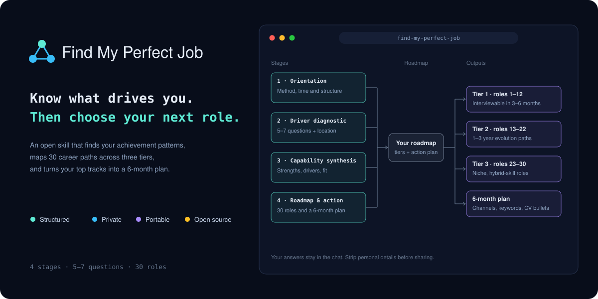

# Find My Perfect Job

An AI skill that acts as a career coach. It works through a structured diagnostic to find your achievement patterns, energy drivers and competitive advantages, then builds a tiered career roadmap and a 6-month action plan.

Most career planning matches keywords on a CV to job descriptions. That often produces roles that look right on paper but drain energy or stall momentum. This skill starts with how you work, what you find engaging, and what drains you, and only then moves to job titles.

## What it does

The skill runs in four stages.

1. **Orientation.** Explains the approach, the time commitment and the structure.
2. **Intrinsic driver diagnostic.** Your location and work-setting preferences, plus 5–7 reflective questions about peak moments, ambiguous problems, flow states, adversity, draining conditions, energy drivers and long-term direction. You choose how many to answer. Answering more questions, with concrete examples, gives a more accurate result.
3. **Capability synthesis.** A breakdown of your cross-disciplinary strengths, behavioural drivers, external benchmarks such as salary or status, location fit, and a note on how reliable the conclusions are given how many questions you answered.
4. **Roadmap and action plan.** Thirty pathways in three tiers:
   - **Tier 1 (roles 1–12):** roles you could realistically interview for within 3–6 months.
   - **Tier 2 (roles 13–22):** 1–3 year paths that need extra credentials, a domain shift or commercial ownership.
   - **Tier 3 (roles 23–30):** niche roles that use a rare combination of skills.

   It then turns your chosen top 3–4 tracks into a 6-month execution timeline and a CV reframing matrix.

The skill works in stages and waits for your answers before moving on. It does not give role suggestions until the diagnostic is complete.

## How to use it

Install it in whichever environment you use.

- **Claude Code:** copy this folder to `~/.claude/skills/find-my-perfect-job/`.
- **Claude.ai:** upload the folder as a custom skill in your settings. Availability depends on your plan.

Then start a conversation and invoke the skill by name, for example `/find-my-perfect-job`, or ask for help planning your career. Start with your location and work-setting preferences. Then answer at least five diagnostic questions. Answering all seven gives the most accurate result. Real examples give far better results than general statements.

## Limitations

Please read these before relying on the output.

- **It is a structured self-reflection tool, not a psychometric test.** Concepts such as "cognitive signature" or "flow state" are useful prompts for reflection. They are not validated scientific measures.
- **Your answers are self-reported.** They can be shaped by your mood or by how you happen to describe your experience. If a conclusion doesn't match your own sense of yourself, say so and push back.
- **The "30 roles" number is a design choice, not a finding.** Not every role will fit your situation. Treat the list as a starting point for judgement, not a shortlist to apply to.
- **Salary and employer information goes stale and varies by market.** Check any figures against current, local sources before making decisions.
- **It is not career, legal, immigration or financial advice.** For visa, contract or financial questions, consult a qualified professional.

## Privacy

Your answers and any CV you share stay in the conversation with your AI tool, subject to that tool's data policy. Before you publish or share anything you produce with this skill, remove personal details such as your name, employer, location, colleagues, or any health, family or financial information. Do not commit personal answers or CVs to this repository.

## Customising

The behaviour is defined entirely in `SKILL.md`. You can edit the diagnostic questions, the number of roles per tier, the depth of the CV reframing or the tone. If you change the structure, keep the stage headings consistent so the flow still makes sense.

## Licence

